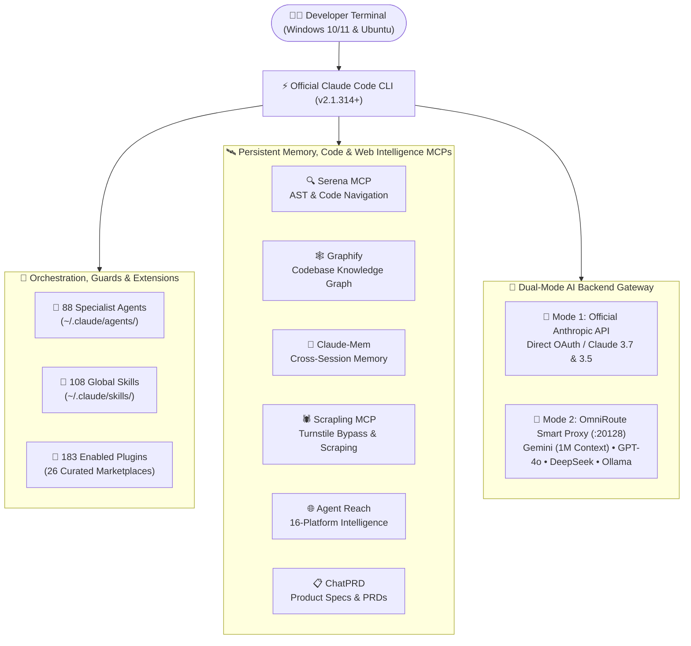

<p align="center">
  
</p>

# ⚡ Extreme Claude
### Universal Claude Code & Multi-Agent AI Engineering Ecosystem

*A turnkey, sanitized starter pack that transforms **Claude Code** into a full-stack autonomous engineering workstation—pre-loaded with **88 Specialist Agents**, **108 Global Skills**, **183 Plugins**, **26 Curated Marketplaces**, **6 Intelligence MCPs**, and **OmniRoute Multi-Model Routing**.*

[](LICENSE)
[](https://github.com/Moamen-R/extreme-claude/releases)
[](https://claude.com/claude-code)
[](#-quick-installation-1-click)
[](#-option-1-run-instantly-via-npx-zero-setup)

<p align="center">
  <a href="#-architecture--ecosystem">Architecture</a> •
  <a href="#-what-this-includes">Features</a> •
  <a href="#-quick-installation-1-click">1-Click Install</a> •
  <a href="#-curated-global-skills-suite">Skills Suite</a> •
  <a href="#-ai-backend-options-official-claude-vs-omniroute">AI Routing</a> •
  <a href="#-deployed-directory-topology">File Topology</a> •
  <a href="#-verification-commands">Verify</a>
</p>

</div>

---

> [!TIP]
> **Instant 1-Command Launch (Windows & Ubuntu Linux):**
> Run straight from your terminal with zero manual cloning or token setup:
> ```bash
> npx github:Moamen-R/extreme-claude
> ```

---

## 🏗️ Architecture & Ecosystem

**Extreme Claude** unifies Anthropic's official CLI with persistent cross-session memory, AST code navigation, codebase knowledge graphs, stealth web scraping, and an optional local multi-model proxy—all merged with **zero configuration conflicts**.



---

## 🌟 What This Includes

### 1. Official Claude Code CLI & Plugin Ecosystem
- **Automated Global Setup**: Installs `@anthropic-ai/claude-code` globally with sanitized defaults.
- **26 Curated Marketplaces & 183 Enabled Plugins**: Pre-configured out of the box (including `nextjs`, `hyperframes`, `impeccable`, `caveman`, `understand-anything`, `diagram-design`, `cli-anything`, `career-ops`, `reactive-resume`, `superpowers`, `omc`, and more).
- **Defensive Guardrails**: Clean, pre-configured tool-use guards and lifecycle hooks that prevent destructive operations.

---

### 2. 88 Custom Specialist Agents (`~/.claude/agents/`)
Domain-tuned autonomous personas ready to be invoked for specialized engineering workflows:

| Domain Category | Capabilities & Focus Areas |
| :--- | :--- |
| **🎨 Frontend & UI/UX** | React 19 / Next.js 15 architecture, anti-slop art direction, design systems, WCAG 2.2 accessibility, Core Web Vitals |
| **⚙️ Backend & Systems** | Distributed systems, API design, microservices, high-concurrency pipelines, systems programming |
| **🛡️ Security & AppSec** | Penetration testing, vulnerability auditing, threat modeling, zero-trust auth flows |
| **🗄️ Data & AI/ML** | Database query optimization, schema migrations, RAG pipelines, LLM evaluation & prompt engineering |
| **🔍 Quality & DevOps** | Automated code review, architectural refactoring, Git conflict resolution, CI/CD automation |

---

### 3. Persistent Memory, Code Graph & Web Intelligence MCPs

| Component | Role | Key Capabilities |
| :--- | :--- | :--- |
| **💾 Claude-Mem** | Cross-Session Memory | Persistent memory compression engine, session lifecycle hooks, and progressive disclosure search (`claude-mem mcp`). |
| **🔍 Serena Agent** | AST Code Intelligence | Symbol-level semantic code navigation and structural refactoring MCP. |
| **🕸️ Graphify** | Knowledge Graph | Persistent AST codebase graph indexing (`graphify query`, `graphify path`, `graphify explain`). |
| **🕷️ Scrapling** | Stealth Web Scraping | Adaptive scraping framework with Cloudflare Turnstile bypass, anti-bot circumvention, and `scrapling-mcp` stdio server. |
| **🌐 Agent Reach** | Multi-Platform Router | Live internet intelligence across 16 platforms (X/Twitter, Reddit, GitHub, YouTube, LinkedIn, Bilibili, Xiaohongshu, V2EX, RSS, Web Reader). |
| **📋 ChatPRD** | Product Management | Native MCP integration for generating and refining Product Requirement Documents. |

---

### 4. OmniRoute Smart AI Router
Local high-speed gateway (`http://localhost:20128/`) enabling Claude Code to dynamically route tasks across **Gemini (1M context window)**, **Claude 3.5/3.7**, **OpenAI (GPT-4o)**, **DeepSeek (V3/R1)**, **OpenRouter**, and local **Ollama / vLLM** instances.

---

## 🚀 Quick Installation (1-Click)

### ⚡ Option 1: Run Instantly via NPX (Zero Setup)
No manual cloning, personal access tokens, or custom registry configuration required:

```bash
# Launch interactive cross-platform installer (auto-detects Windows vs. Linux)
npx github:Moamen-R/extreme-claude
```

#### Built-in CLI Maintenance Commands:
```bash
# Update all installed global skills to their latest upstream commits
npx github:Moamen-R/extreme-claude update

# Re-sync and repair curated skills from live upstream repositories
npx github:Moamen-R/extreme-claude skills
```

---

### 💻 Option 2: Clone & Run Locally

```bash
git clone https://github.com/Moamen-R/extreme-claude.git
cd extreme-claude
```

#### 🪟 Windows (10 / 11)
- **Method A (1-Click Batch Launcher)**: Double-click `setup.bat` (or right-click → **Run as Administrator**).
- **Method B (PowerShell)**:
  ```powershell
  powershell -NoProfile -ExecutionPolicy Bypass -File .\Install-ClaudeSetup.ps1
  ```
  *The script will:*
  1. Verify or install Node.js (v22 LTS) and Astral `uv`.
  2. Install Python-based intelligence tools (`serena-agent`, `graphifyy`, and `scrapling[ai]`) via `uv`.
  3. Install `@anthropic-ai/claude-code`, `omniroute`, `claude-mem`, `skills`, and ecosystem CLIs globally via `npm`.
  4. Deploy all 88 specialist agents, 108 global skills, 183 plugins across 26 marketplaces, and merged MCP configurations to `~/.claude` and `~/.claude.json`.

---

#### 🐧 Ubuntu Linux
Run the installer script directly from your terminal:
```bash
chmod +x install.sh && ./install.sh
```
*(Alternatively, run `./setup.sh`)*

*The Linux installer will:*
1. Install core system & build dependencies (`curl`, `git`, `build-essential`, `python3`, `sqlite3`, etc.).
2. Provision Node.js 22 LTS via NodeSource.
3. Install Astral `uv` along with `serena-agent`, `graphifyy`, and `scrapling[ai]`.
4. Install `@anthropic-ai/claude-code`, `omniroute`, `claude-mem`, `skills`, and ecosystem CLIs globally.
5. Deploy all configurations, agents, skills, and MCP definitions to `$HOME/.claude` and `$HOME/.claude.json`.
6. Configure OmniRoute as an automated `systemd` user service listening on port 20128.

---

## 🧰 Curated Global Skills Suite

All skills are installed at global user scope (`~/.claude/skills/`) and tracked via `configs/skills.json` for 1-command upstream updates:

| Category | Skill | Upstream Source | Description |
| :--- | :--- | :--- | :--- |
| **🏗️ Architecture & Planning** | **`grill-with-docs`** | [`mattpocock/skills`](https://github.com/mattpocock/skills) | Challenge and refine technical plans against official documentation |
| **🏗️ Architecture & Planning** | **`improve-codebase-architecture`** | [`mattpocock/skills`](https://github.com/mattpocock/skills) | Deep architectural analysis and dependency refactoring |
| **🏗️ Architecture & Planning** | **`wayfinder`** | [`mattpocock/skills`](https://github.com/mattpocock/skills) | Deconstruct large milestones into actionable decision tickets |
| **🏗️ Architecture & Planning** | **`triage`** | [`mattpocock/skills`](https://github.com/mattpocock/skills) | Scope-boundary triage and out-of-scope issue management |
| **🏗️ Architecture & Planning** | **`writing-for-agents`** | [`mattpocock/skills`](https://github.com/mattpocock/skills) | Write high-signal, token-efficient documentation for AI agents |
| **🏗️ Architecture & Planning** | **`setup-matt-pocock-skills`** | [`mattpocock/skills`](https://github.com/mattpocock/skills) | Bootstrap the complete Matt Pocock engineering skill suite |
| **🎨 Frontend & UI** | **`vercel-react-best-practices`** | [`vercel-labs/agent-skills`](https://github.com/vercel-labs/agent-skills) | React 19 and Next.js 15 performance & server/client patterns |
| **🎨 Frontend & UI** | **`design-taste-frontend`** | [`leonxlnx/taste-skill`](https://github.com/leonxlnx/taste-skill) | Anti-slop frontend art direction, color palettes, and layout engine |
| **🎨 Frontend & UI** | **`redesign-existing-projects`** | [`leonxlnx/taste-skill`](https://github.com/leonxlnx/taste-skill) | Targeted UI/UX redesign workflow for existing interfaces |
| **⚡ Web Quality & Perf** | **`web-quality-audit`** | [`addyosmani/web-quality-skills`](https://github.com/addyosmani/web-quality-skills) | Comprehensive evidence-led Lighthouse & web quality auditing |
| **⚡ Web Quality & Perf** | **`core-web-vitals`** | [`addyosmani/web-quality-skills`](https://github.com/addyosmani/web-quality-skills) | LCP, INP, and CLS bottleneck diagnosis and tuning |
| **⚡ Web Quality & Perf** | **`performance`** | [`addyosmani/web-quality-skills`](https://github.com/addyosmani/web-quality-skills) | Runtime execution speed and asset delivery optimization |
| **⚡ Web Quality & Perf** | **`accessibility`** | [`addyosmani/web-quality-skills`](https://github.com/addyosmani/web-quality-skills) | WCAG 2.2 accessibility auditing and ARIA remediation |
| **⚡ Web Quality & Perf** | **`seo`** | [`addyosmani/web-quality-skills`](https://github.com/addyosmani/web-quality-skills) | Technical SEO, crawlability, and structured metadata |
| **🛡️ Code Review & Git** | **`code-review`** | [`mattpocock/skills`](https://github.com/mattpocock/skills) | Strict standards-based and spec-driven code reviewer |
| **🛡️ Code Review & Git** | **`open-code-review`** | [`alibaba/open-code-review`](https://github.com/alibaba/open-code-review) | Automated diff-based AI code review and fix engine |
| **🛡️ Code Review & Git** | **`git-guardrails-claude-code`** | [`mattpocock/skills`](https://github.com/mattpocock/skills) | Defensive Git safety hooks blocking destructive commands |
| **🛡️ Code Review & Git** | **`resolving-merge-conflicts`** | [`mattpocock/skills`](https://github.com/mattpocock/skills) | Structured Git merge and rebase conflict resolution |
| **🌐 Web, Graph & Meta** | **`agent-browser`** | [`vercel-labs/agent-browser`](https://github.com/vercel-labs/agent-browser) | Headless & GUI browser automation CLI for AI agents |
| **🌐 Web, Graph & Meta** | **`scrapling-official`** | [`D4Vinci/Scrapling`](https://github.com/D4Vinci/Scrapling) | Cloudflare Turnstile bypass and adaptive stealth scraping |
| **🌐 Web, Graph & Meta** | **`agent-reach`** | [`agent-reach/agent-reach`](https://github.com/agent-reach/agent-reach) | Multi-platform internet intelligence router (16 platforms) |
| **🌐 Web, Graph & Meta** | **`graphify`** | [`graphify-ai/graphify`](https://github.com/graphify-ai/graphify) | Persistent AST codebase knowledge graph indexing |
| **🌐 Web, Graph & Meta** | **`find-skills`** | [`vercel-labs/agent-skills`](https://github.com/vercel-labs/agent-skills) | Discover and install community agent skills from skills.sh |
| **🌐 Web, Graph & Meta** | **`caveman`** | [`juliusbrussee/caveman`](https://github.com/juliusbrussee/caveman) | Ultra-terse, high-density output mode minimizing token burn |
| **⚡ Next.js Runtime** | **`next-dev-loop`** | [`vercel/next.js`](https://github.com/vercel/next.js) | Verify Next.js runtime behavior combining /_next/mcp and agent-browser |
| **⚡ Next.js Runtime** | **`next-bundle-optimizer`** | [`vercel/next.js`](https://github.com/vercel/next.js) | Audit and reduce Next.js browser initial-load bundle work |
| **⚡ Next.js Runtime** | **`next-cache-components-adoption`** | [`vercel/next.js`](https://github.com/vercel/next.js) | Adopt Cache Components and resolve blocking routes in Next.js |
| **⚡ Next.js Runtime** | **`next-partial-prefetching-adoption`** | [`vercel/next.js`](https://github.com/vercel/next.js) | Adopt Partial Prefetching and verify prefetching behavior |
| **🎨 Design & Craft** | **`impeccable`** | [`pbakaus/impeccable`](https://github.com/pbakaus/impeccable) | Design fluency, UX critique, polish, audit, and design tokens |
| **📊 Diagram & Architecture** | **`diagram-design`** | [`cathrynlavery/diagram-design`](https://github.com/cathrynlavery/diagram-design) | Branded architecture, flowchart, sequence, ERD, and system diagrams |
| **🧠 Codebase Comprehension** | **`understand`** | [`Egonex-AI/Understand-Anything`](https://github.com/Egonex-AI/Understand-Anything) | Interactive architectural knowledge graphs and component mapping |
| **🧠 Codebase Comprehension** | **`understand-diff`** | [`Egonex-AI/Understand-Anything`](https://github.com/Egonex-AI/Understand-Anything) | Blast radius, dependency trace, and risk analysis for PRs |
| **🎬 Video & Media Motion** | **`hyperframes`** | [`heygen-com/hyperframes`](https://github.com/heygen-com/hyperframes) | Create, edit, animate, and render production videos from HTML |
| **🎬 Video & Media Motion** | **`hyperframes-cli`** | [`heygen-com/hyperframes`](https://github.com/heygen-com/hyperframes) | Video scaffolding, timeline inspection, and rendering pipeline |
| **🛠️ Harness Engineering** | **`cli-anything`** | [`HKUDS/CLI-Anything`](https://github.com/HKUDS/CLI-Anything) | Build stateful CLI harnesses for GUI applications with Click & REPL |
| **🎯 Cognitive Flow** | **`i-have-adhd`** | [`ayghri/i-have-adhd`](https://github.com/ayghri/i-have-adhd) | Action-first, numbered steps, tangent-free output shaping |
| **📦 Headless CMS** | **`payload`** | [`payloadcms/payload`](https://github.com/payloadcms/payload) | Collections, fields, hooks, access control, and database adapters |
| **💼 Career & Job Search** | **`career-ops`** | [`career-ops-hq/career-ops`](https://github.com/career-ops-hq/career-ops) | AI job search agent: scan portals, evaluate JDs, tailor CVs, and track applications |
| **💼 Career & Job Search** | **`resume-tailor`** | [`reactive-resume/reactive-resume`](https://github.com/reactive-resume/reactive-resume) | Tailor resumes and cover letters with ATS keyword alignment |
| **💼 Career & Job Search** | **`resume-builder`** | [`reactive-resume/reactive-resume`](https://github.com/reactive-resume/reactive-resume) | Build importable Reactive Resume JSON conforming to schema |
| **💼 Career & Job Search** | **`mock-interview`** | [`reactive-resume/reactive-resume`](https://github.com/reactive-resume/reactive-resume) | Interactive scored mock interviews for specific roles and personas |

---

## 🔑 AI Backend Options: Official Claude vs. OmniRoute

During installation, you will be prompted to select your preferred AI backend mode. You can switch between both at any time:

| Feature | 🌟 Option 1: Official Anthropic Claude (Default) | 🔀 Option 2: OmniRoute Smart AI Router |
| :--- | :--- | :--- |
| **Endpoint** | `https://api.anthropic.com` (Direct) | `http://localhost:20128/` (Local Smart Gateway) |
| **Authentication** | Native Web OAuth (`claude login`) or Anthropic API Key | Provider API Keys / Local Ollama or vLLM |
| **Supported Models** | Claude 3.7 / 3.5 Sonnet, Opus, Haiku | Gemini 1.5/2.0, GPT-4o, DeepSeek V3/R1, Claude, Ollama |
| **Max Context Window** | 200K Tokens | Up to 1,000,000 Tokens (via Gemini) |
| **Best For** | Claude Pro / Team / Enterprise subscribers wanting zero local proxy overhead | Multi-model routing, massive repo context, and cutting API token costs |

### 🌟 Using Option 1: Official Anthropic Claude
1. Select **Official Anthropic Claude** during installation.
2. Run `claude` in your terminal and complete standard web OAuth (`claude login`) if prompted.

### 🔀 Using Option 2: OmniRoute Smart AI Router
1. Start the local router:
   ```bash
   omniroute serve
   ```
   *(Note: On Ubuntu Linux, OmniRoute runs automatically in the background as a systemd user service).*
2. Open the local dashboard at `http://localhost:20128/` to configure your provider keys (Gemini, OpenAI, DeepSeek, OpenRouter, or local Ollama).
3. Launch `claude`—all agent and CLI requests will transparently route through OmniRoute.

---

## 📂 Deployed Directory Topology

Extreme Claude keeps your environment clean and modular by deploying strictly into standard Claude configuration paths:

```text
~/.claude/
├── agents/                  # 88 Custom domain-specialist agent definitions (.md)
├── skills/                  # 27+ Global upstream-tracked skills
│   ├── agent-browser/
│   ├── design-taste-frontend/
│   ├── graphify/
│   ├── scrapling-official/
│   └── ...
├── plugins/                 # 174 Enabled community plugins across 18 marketplaces
└── settings.json            # Sanitized tool-use guards, permissions & lifecycle hooks

~/.claude.json               # Pre-wired MCP server registrations (Serena, Graphify, Claude-Mem, Scrapling, etc.)
```

---

## 🛠️ Verification Commands

Run these checks after installation to verify every tool and MCP server is online:

### 🪟 Windows (PowerShell)
```powershell
claude --version
omniroute status
serena --help
graphify --help
claude-mem status
scrapling --help
agent-reach doctor
```

### 🐧 Ubuntu Linux (Bash)
```bash
claude --version
systemctl --user status omniroute
~/.local/bin/serena --help
~/.local/bin/graphify --help
claude-mem status
scrapling --help
agent-reach doctor
```

---

## 📄 License

Distributed under the MIT License. See [LICENSE](LICENSE) for full details.
